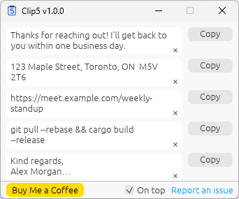

Clip5 is a tiny window that stays on top of your other apps and holds five pieces of text. Click a slot's button to copy its text to the clipboard, or the small × in the slot to clear it. Type or paste into a slot to change it. Everything is saved automatically.

{fig-alt="The Clip5 window: five text slots with a Copy button beside each, plus a Buy Me a Coffee button, an On top checkbox, and a Report an issue link." width="342"}

Long text is shortened with "…" so the window stays small. Make the window taller to see more of each slot. Click a slot to see and edit all of it; while you're editing, the slot scrolls instead. The **Copy** button always copies the full text. Spaces and blank lines around pasted text are removed automatically.

## Download

Get the latest version from the [Releases page](https://github.com/pbeens/Clip5/releases/latest).

- **Windows:** download the `.exe`. There's nothing to install: move it wherever you like and double-click it. If Windows shows "Windows protected your PC", click **More info**, then **Run anyway**. The app is free and not code-signed.
- **macOS:** download and unzip the `.zip`, then drag `Clip5.app` into your **Applications** folder. The first time you open it, macOS can't verify the developer. Click **Done**, then go to **System Settings → Privacy & Security** and click **Open Anyway**.

Your text is stored separately from the program, so moving the program doesn't affect it.

## Help and feedback

Found a bug or have an idea? [Open an issue on GitHub](https://github.com/pbeens/Clip5/issues).

## Open source

Clip5 is free and open source under the [MIT licence](https://github.com/pbeens/Clip5/blob/main/LICENSE). You're welcome to download the code, change it, and build your own version.

In short:

1. **Install Rust** from [rustup.rs](https://rustup.rs/). On Windows, accept the offer to install the Visual Studio C++ Build Tools. On macOS, run `xcode-select --install` first.
2. **Get the code:** download the ZIP from the [GitHub repository](https://github.com/pbeens/Clip5) (**Code → Download ZIP**), or open it with [GitHub Desktop](https://desktop.github.com/) if you want updates and plan to contribute.
3. **Run it:** open a terminal in the `Clip5` folder and type `cargo run`.
4. **Build your own app:** `cargo build --release` on Windows, or `cargo bundle --release` on macOS.

More details are in the [README](https://github.com/pbeens/Clip5#building-from-source), including how to make changes and contribute.

## Support Clip5

If Clip5 saves you time, please consider buying me a coffee.

